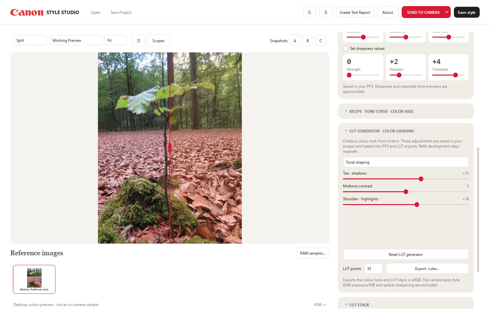

# Canon Style Studio

**Create Canon Picture Styles and colour LUTs on Windows.**

[Download v1.0.0](https://github.com/LvClFER/Lut-to-Canon-Picture-Style/releases/tag/v1.0.0) · [Quick start](docs/QUICK_START.md) · [Camera compatibility](CAMERA_COMPATIBILITY.md) · [Release notes](RELEASE_NOTES.md) · [Technical docs](docs/README.md)

## What it does

- Import `.cube` LUTs, Hald images and PF3 styles; create a look with RGB gamma, colour, tonal and six-axis adjustments.
- Preview before/after with a draggable divider, compare two LUTs and use snapshots A/B/C.
- Save one editable `.canonstyleproject`, reopen it, and keep your currently loaded reference photos when changing styles.
- Export Canon `.pf3` styles and 17-, 33- or 65-point `.cube` LUTs. Six generated base styles are included; new projects use Standard.
- Develop supported RAW files. Exact Canon base-style rendering uses an optional local Picture Style Editor installation; LibRaw fallback is not an exact Canon rendering substitute.
- Optionally find RAW samples through a user-operated DPReview browser, retaining source and author credit.
- Install styles through the independent Windows USB workflow with camera/slot selection, backup and readback checks. **This feature is experimental.**

## Download and run

**Camera safety:** This is unofficial software. Experimental direct USB/PTP communication carries a risk of camera malfunction or damage. EOS RP testing and readback checks do not make untested cameras safe. Use camera installation at your own risk; there is no automatic rollback.

Download **CanonStyleStudio_1.0.0_Windows_x64.zip** from the release, extract the whole ZIP, then run `CanonStyleStudio.exe`. Keep the `runtime` folder beside it. Python, Java and Node.js do not need to be installed. User-created styles go into **Documents / Canon Style Studio PF3**.

Version 1.0.0 is the first stable **Windows editor** release. Camera-installation compatibility is a separate validation question: independent physical testing covers the **EOS RP**; other models remain experimental. The compiler catalog is not a list of cameras physically tested with this app. See the [compatibility notes](CAMERA_COMPATIBILITY.md) before using USB installation. A failed USB session may require disconnecting or restarting the camera; there is no automatic retry or rollback.

## Current limits

- `.cube` exports contain the colour look and enabled LUT stack, not RAW exposure/WB, the full camera base rendering or spatial sharpening. RAW exposure/WB are not written into a Picture Style either.
- Existing camera-slot Basic controls must match the independent installation requirements; conflicting values are blocked.
- Nikon `.np3` colour conversion is **not available**. Reading its records does not establish faithful rendering.
- Android and macOS sources are under development; this release ships the Windows build only.
- A preview is not a guarantee that every camera will produce an identical JPEG. Canon RAW development, imported PF3 preview and hardware coverage each have their documented limits.

## Development disclosure

**Developed by Filipe with extensive assistance from OpenAI Codex**, including implementation, reverse-engineering research, debugging, tests, packaging and documentation. AI-assisted work and automated tests are not independent certification or proof of compatibility with untested cameras. Hardware-test claims are limited to the evidence in the compatibility notes.

Thanks to [kianimo](https://github.com/kianimo) for the export bug reports and proposed fixes in PRs [#1](https://github.com/LvClFER/Lut-to-Canon-Picture-Style/pull/1), [#2](https://github.com/LvClFER/Lut-to-Canon-Picture-Style/pull/2) and [#3](https://github.com/LvClFER/Lut-to-Canon-Picture-Style/pull/3).

This is an independent community project, not an official Canon product. Canon and Nikon names/logos belong to their respective owners. [Demo image credits](docs/images/CREDITS.md).
